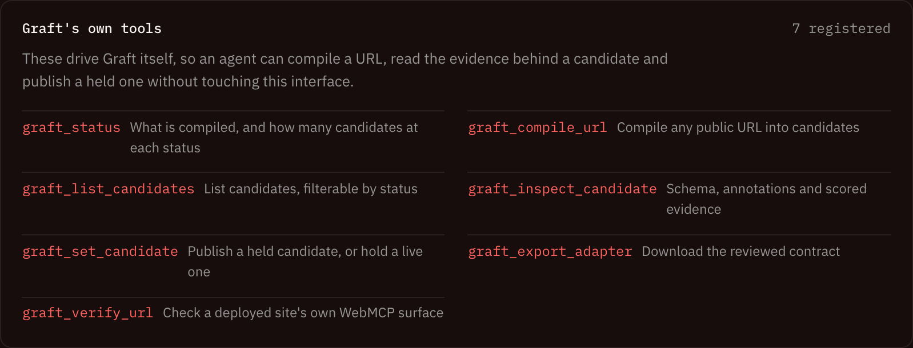
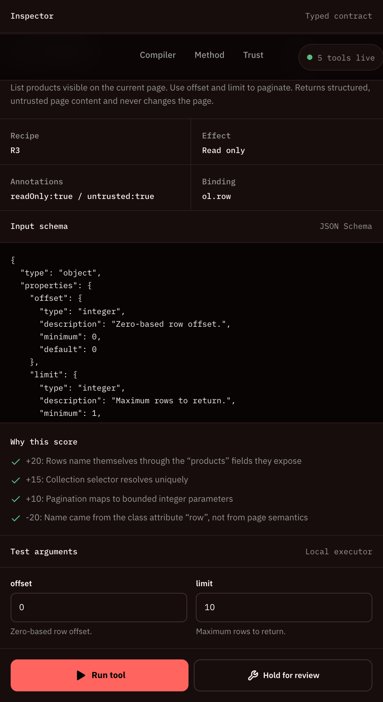
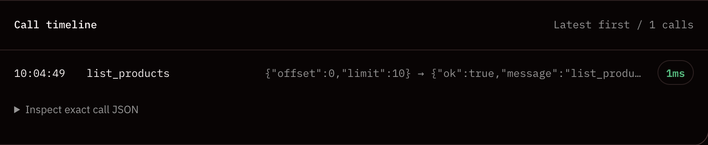

<div align="center">

# Graft

**Turn any public website's semantic HTML into reviewed, governed [WebMCP](https://github.com/webmachinelearning/webmcp) tools.**

[](https://github.com/himanshu748/graft-webmcp/actions/workflows/ci.yml)
[](LICENSE)
[](CONTRIBUTING.md)

[Live demo](https://graft-webmcp.vercel.app) · [Technical spec](docs/TECHNICAL_SPEC.md) · [Demo runbook](docs/DEMO_RUNBOOK.md) · [Report a bug](https://github.com/himanshu748/graft-webmcp/issues/new/choose)



</div>

## Why Graft?

Agents shouldn't have to scrape pages. WebMCP lets a site expose typed tools to in-browser agents, but writing those contracts by hand is tedious and easy to get wrong. Graft compiles a page's existing semantic HTML into candidate tools, scores them with visible evidence, and keeps a human in the loop before anything ships.

## Features

- **Compile** – fetches a public page once, sanitizes it, and derives typed candidates from search forms, repeated content, and tables.
- **Explainable scoring** – every candidate carries evidence; ambiguous ones are held for review.
- **Safe by default** – reviewed read-only tools export as a self-contained adapter with the runtime included. Write tools need owner implementation and are never registered automatically.
- **Verify** – checks deployed tools for valid contracts, unique names, and drift from expected names.
- **Live search replay** – replays search where a page declares a GET endpoint.

| Confidence & evidence | Execution timeline |
| --- | --- |
|  |  |

## Demonstrated

| Target | Result |
| --- | --- |
| Signal Cabinet | 7 candidates: 5 approved read-only tools, 1 held write, 1 rejected false positive. Owner deployed 6 tools on a separate origin and passed verification. |
| OmniDev Agent Lab | 8 registered tools; `apply_patch` only modifies an in-memory fixture and requires confirmation. |
| Allbirds (Shopify) | Verifier found 10 tools, all with contract-quality issues against Chrome guidance. |
| Python.org | Live search returned 20 results; export smoke test registered all 5 eligible tools without owner handlers. |

## Quick start

Requires Node.js 20.19+ and npm 10+.

```bash
git clone https://github.com/himanshu748/graft-webmcp.git
cd graft-webmcp
npm install
npm run dev
```

| Command | Purpose |
| --- | --- |
| `npm run dev` | Build the runtime and start the dev server |
| `npm test` | Run the test suite |
| `npm run build` | Type-check and produce a production build |
| `npm run check:owner-adapter` | Ensure the example owner adapter is up to date |

For local WebMCP verification, use Chrome 149+ with the WebMCP testing flag enabled.

## Project layout

```
api/        Serverless endpoints (fetch, verify) and network guards
src/        React app, control plane, sanitizer, adapter export, runtime
scripts/    Adapter build and smoke-test scripts
examples/   Owner-site demo using an exported adapter
docs/       PRD, technical spec, runbook, screenshots
```

## Safety and limits

- Refuses sensitive domain categories and private/link-local addresses; checks redirects and honors `robots.txt`.
- Does not forward credentials, cache target content, execute target scripts, or serve fetched pages. Snapshot content is treated as untrusted.
- Rendering is optional; client-rendered or bot-protected sites may yield little or be refused.
- Rendering uses serverless Chromium with `--no-sandbox`; DNS rebinding remains a stated residual risk.

See [SECURITY.md](SECURITY.md) to report vulnerabilities.

## Contributing

Contributions are welcome! Read [CONTRIBUTING.md](CONTRIBUTING.md) and our [Code of Conduct](CODE_OF_CONDUCT.md), then browse [open issues](https://github.com/himanshu748/graft-webmcp/issues) — look for `good first issue`.

## License

[MIT](LICENSE)
